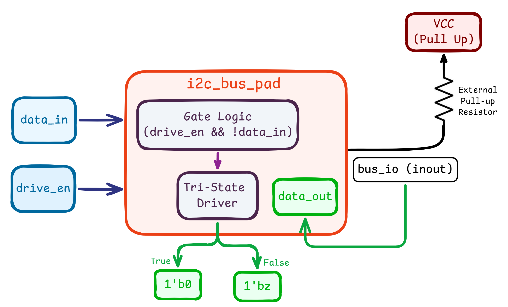
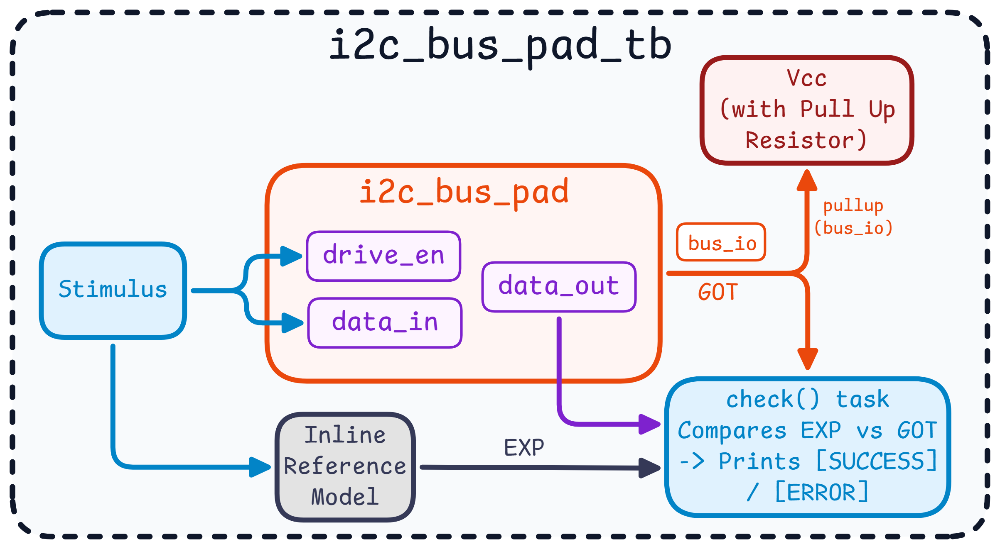

# Week 1: Bidirectional Open-Drain Bus Pad (`i2c_bus_pad`)

## Overview

I2C lines (`SDA` and `SCL`) are open-drain. A device can pull the line low, but it can never drive it high. To send a `1`, it lets go of the line (high-impedance, `1'bz`) and an external pull-up resistor brings the line up. Because nobody ever drives the line high, two devices talking at once can't short the supply to ground.

This module sits between the core logic and a bidirectional `inout` pin. It handles the drive-low / release behavior on the way out and reports the actual state of the pin on the way back in.

## Block Diagrams

### RTL



### Testbench



## Behavior

| `drive_en` | `data_in` | `bus_io` driven as | Bus level (with pull-up) | `data_out` | What's happening |
| :---: | :---: | :---: | :---: | :---: | :--- |
| `1` | `0` | `1'b0` | `0` | `0` | The module pulls the line to ground. |
| `1` | `1` | `1'bz` | `1` | `1` | The module releases the line and the pull-up brings it high. |
| `0` | `X` | `1'bz` | `1`, or `0` if another device is pulling it low | same as bus | The module stays off the bus and just listens. |

## Notes on the Design

- **Never drives high.** The pad only pulls low or releases, so there is no contention when two devices drive the bus at the same time.
- **`data_out` always reflects the real pin.** It reads `bus_io` directly, not the value the module intended to drive. That is what lets a master notice that another device is holding the line low.
- **The testbench models the pull-up.** It uses Verilog's `pullup` primitive so a released line actually settles to `1`, the way it would on a real board.
- **The testbench checks itself.** A `check` task works out the expected bus level from the inputs (a released line counts as `1`, standing in for the pull-up) and compares it against `bus_io` and `data_out`, printing the expected and actual values on a mismatch.

## Simulation Results

`i2c_bus_pad_tb.sv` runs every combination of `drive_en` and `data_in`:

```text
# [SUCCESS] data_in=0, drive_en=1 -> bus_io=0, data_out=0
# [SUCCESS] data_in=1, drive_en=1 -> bus_io=1, data_out=1
# [SUCCESS] data_in=1, drive_en=0 -> bus_io=1, data_out=1
# [SUCCESS] data_in=0, drive_en=0 -> bus_io=1, data_out=1
# Errors: 0, Warnings: 0
```

## Files

| File | Description |
| :--- | :--- |
| [`i2c_bus_pad.sv`](rtl/i2c_bus_pad.sv) | The bus pad RTL |
| [`i2c_bus_pad_tb.sv`](testbench/i2c_bus_pad_tb.sv) | Self-checking testbench covering all input combinations |