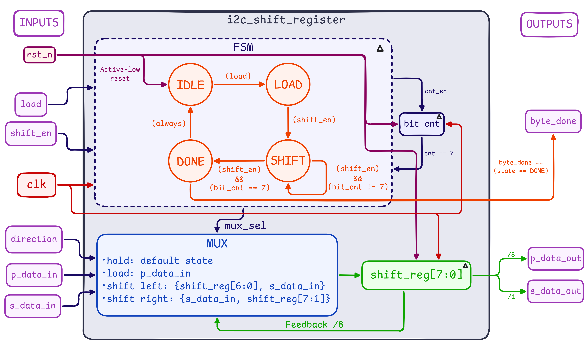

# Week 2: I2C Shift Register (`i2c_shift_register`)

## Overview

I2C moves data one bit at a time, 8 bits per byte, MSB first. The core logic works with whole bytes, so something has to convert between the two. That is the job of this module: it loads a parallel byte, shifts it out serially one bit per `shift_en` pulse (shifting new bits in at the same time), and raises `byte_done` once a full byte of 8 shifts has gone through.

The design is split into a small FSM that decides what happens each cycle, and a datapath that does it: an 8-bit shift register, a 3-bit bit counter, and a mux that picks the register's next value.

## Block Diagrams

### RTL



### Waveform


## Ports

| Port | Dir | Width | Description |
| :--- | :---: | :---: | :--- |
| `clk` | in | 1 | Clock. Everything is synchronous to the rising edge. |
| `rst_n` | in | 1 | Active-low reset. Returns the FSM to `IDLE` and clears the register and bit counter. |
| `load` | in | 1 | Request to load `p_data_in` into the shift register. |
| `shift_en` | in | 1 | Shift by one bit this cycle. |
| `direction` | in | 1 | `0` shifts left (MSB leaves first, the I2C order). `1` shifts right (LSB leaves first). |
| `p_data_in` | in | 8 | Parallel data to load. |
| `s_data_in` | in | 1 | Serial bit shifted into the register. |
| `p_data_out` | out | 8 | Current contents of the shift register. |
| `s_data_out` | out | 1 | Serial bit leaving the register: `shift_reg[7]` when `direction = 0`, `shift_reg[0]` when `direction = 1`. |
| `byte_done` | out | 1 | High while the FSM is in `DONE`, after 8 shifts. |

## Behavior

### FSM

| State | Condition | Next state |
| :---: | :--- | :---: |
| `IDLE` | `load` | `LOAD` |
| `IDLE` | `shift_en` and not `load` | `SHIFT` |
| `IDLE` | otherwise | `IDLE` |
| `LOAD` | `shift_en` | `SHIFT` |
| `LOAD` | otherwise | `IDLE` |
| `SHIFT` | `load` | `LOAD` |
| `SHIFT` | `shift_en` and `bit_cnt == 7` | `DONE` |
| `SHIFT` | otherwise | `SHIFT` |
| `DONE` | `load` | `LOAD` |
| `DONE` | otherwise | `IDLE` |

### Datapath

| State | What happens to the register and counter |
| :---: | :--- |
| `IDLE` | Both hold their values. |
| `LOAD` | `shift_reg <= p_data_in`, `bit_cnt <= 0`. |
| `SHIFT` | If `shift_en`: shift by one bit and `bit_cnt <= bit_cnt + 1`. Otherwise hold. |
| `DONE` | `bit_cnt <= 0`. The register keeps the finished byte. |

The shift itself depends on `direction`:

| `direction` | Shift | New register value |
| :---: | :--- | :--- |
| `0` | Left | `{shift_reg[6:0], s_data_in}` |
| `1` | Right | `{s_data_in, shift_reg[7:1]}` |

## Notes on the Design

- **One byte is exactly 8 shifts.** The counter runs 0 to 7. The shift that happens at `bit_cnt == 7` is the 8th one, and it moves the FSM to `DONE` on the same cycle.
- **`byte_done` is a one-cycle pulse.** It is high only while the FSM is in `DONE`, and `DONE` always leaves on the next cycle, back to `IDLE` or to `LOAD` if `load` is asserted.
- **`load` wins.** From `IDLE`, `SHIFT`, or `DONE`, asserting `load` goes to `LOAD`. Loading partway through a byte throws the half-shifted byte away and starts over.
- **Outputs read straight from the register.** `p_data_out` is always the full register, and `s_data_out` is just a tap on one end of it, chosen by `direction`.
- **The testbench has its own reference model.** It tracks the FSM state, shift register, and bit counter in parallel with the DUT, and compares `p_data_out`, `s_data_out`, and `byte_done` every clock cycle.
- **Stimulus is directed first, then random.** Directed bytes cover both directions with a fixed `s_data_in`. Later bytes use a random `s_data_in`, a `load` in the middle of a byte, and a final stretch of 50 cycles with every input randomized, including `load` and `shift_en`.

## Simulation Results

`i2c_shift_register_tb.sv` prints one line per clock cycle and a summary at the end:

```text
# (<time>) [SUCCESS] Inputs: rst_n=1, load=0, shift_en=1, direction=0, ... | Outputs: p_data_out=..., s_data_out=..., byte_done = ...
# ...
# Done. pass=<N>, errors = <N>
```

## Files

| File | Description |
| :--- | :--- |
| [`i2c_shift_register.sv`](rtl/i2c_shift_register.sv) | The shift register RTL |
| [`i2c_shift_register_tb.sv`](testbench/i2c_shift_register_tb.sv) | Self-checking testbench with a cycle-accurate reference model |
